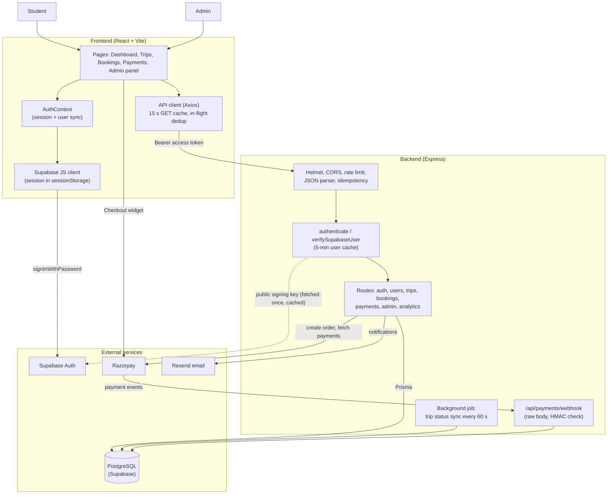
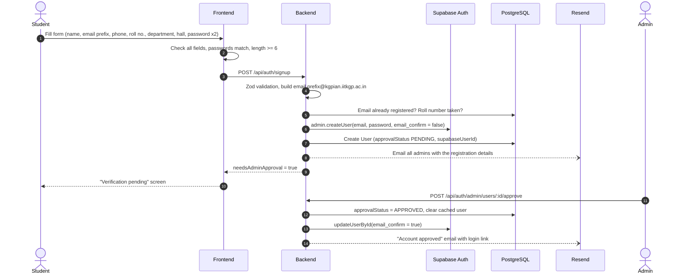
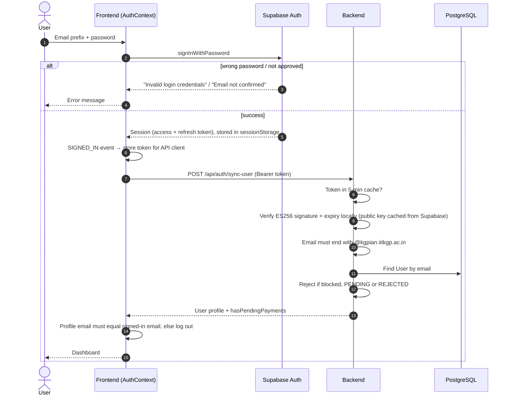
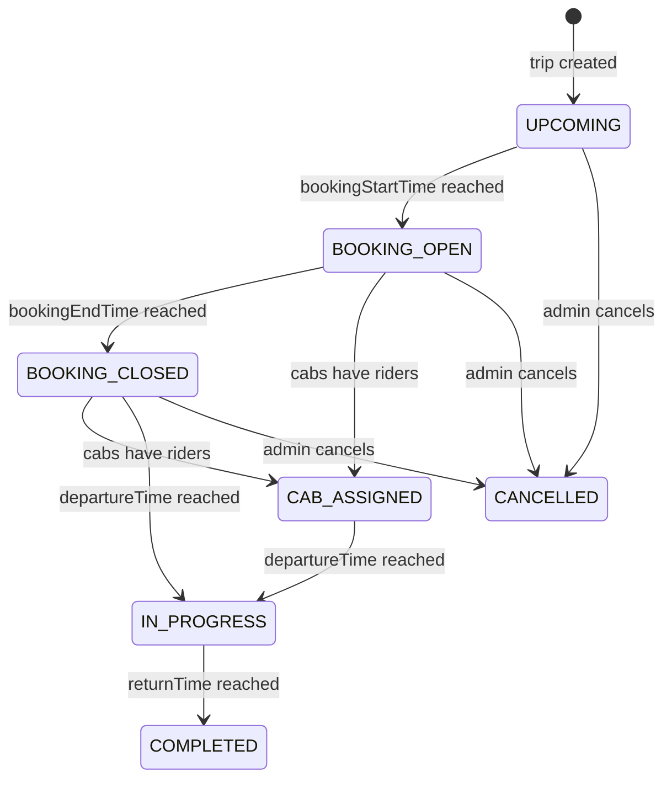
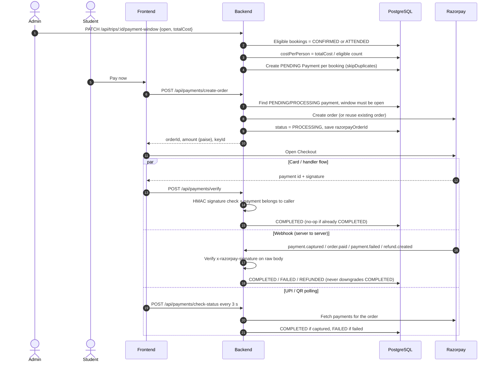
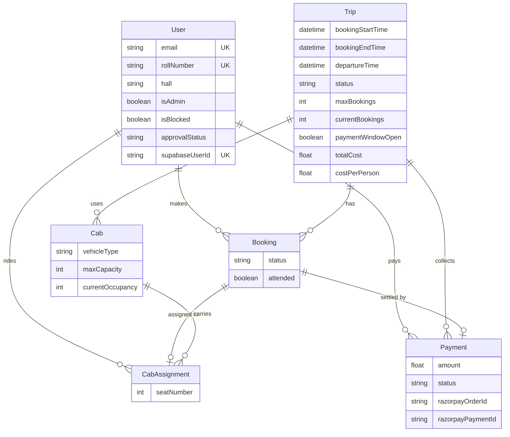

# Friday Cab Management System

A full-stack cab booking platform for IIT Kharagpur students travelling to Friday prayer. It covers the whole trip lifecycle: trip creation, student booking, cab allocation, attendance, post-trip cost sharing and online payment, plus an admin panel for users and analytics.

> **Business rule:** students do not pay when booking. After the trip, the admin enters the total cost, it is split equally among the riders, and each rider pays their share online.

---

## Table of contents

- [Features](#features)
- [Technology stack](#technology-stack)
- [System architecture](#system-architecture)
- [Request lifecycle (backend middleware)](#request-lifecycle-backend-middleware)
- [Registration and admin approval](#registration-and-admin-approval)
- [Login and token verification](#login-and-token-verification)
- [Trip creation and trip lifecycle](#trip-creation-and-trip-lifecycle)
- [Booking and cancellation](#booking-and-cancellation)
- [Cab allocation and attendance](#cab-allocation-and-attendance)
- [Cost sharing and payment](#cost-sharing-and-payment)
- [Idempotency](#idempotency)
- [Caching](#caching)
- [Performance design](#performance-design)
- [Data model](#data-model)
- [Project structure](#project-structure)
- [Running locally](#running-locally)
- [Environment variables](#environment-variables)
- [Deployment notes](#deployment-notes)
- [Known limitations](#known-limitations)

---

## Features

**Students**
- Register with institute email (`@kgpian.iitkgp.ac.in`), phone, roll number, department, hall of residence and password
- Log in with email and password once an admin has approved the account
- Browse trips, book during the booking window, cancel before the cancellation deadline
- See cab assignment, booking history and dashboard stats
- Pay their share of the trip cost through Razorpay (cards, UPI, QR)

**Admins**
- Approve or reject registrations; block users; grant or revoke admin rights
- Create, edit, cancel and delete trips; every active user is emailed about a new trip
- Add cabs to a trip and assign riders automatically or by hand
- Mark attendance, open the payment window with the total cost, track pending payments
- View analytics: monthly summary, daily breakdown, profit/loss, per-user stats

---

## Technology stack

| Layer | Technology |
|---|---|
| Frontend | React, TypeScript, Vite, Tailwind CSS, shadcn/ui, React Router, Axios |
| Backend | Node.js, Express, TypeScript, Zod validation, Helmet, express-rate-limit |
| Database | PostgreSQL on Supabase, accessed through Prisma ORM (`relationJoins` enabled) |
| Authentication | Supabase Auth (email + password), verified by the backend on every request |
| Payments | Razorpay Orders API, Checkout, signature verification and webhooks |
| Email | Resend (trip announcements, admin notifications, approval emails) |

---

## System architecture



**How the pieces fit together**
1. The browser logs in directly with Supabase Auth and receives an access token.
2. Every API call to the Express backend carries that token in the `Authorization` header.
3. The backend verifies the token's signature locally with Supabase's public key, loads the matching user from PostgreSQL, and checks approval, block and admin status before running the route.
4. All business data (users, trips, bookings, cabs, payments) lives in PostgreSQL. The frontend never writes to the database directly.
5. Razorpay handles card/UPI payments. The backend creates orders and verifies every payment server-side, by signature, webhook or direct status query.

---

## Request lifecycle (backend middleware)

Middleware runs in this order (`backend/src/server.ts`):

1. **Helmet**: security headers.
2. **CORS**: in production only `FRONTEND_URL` is allowed.
3. **Razorpay webhook** (`/api/payments/webhook`): mounted *before* the JSON parser so it receives the raw body needed for HMAC verification.
4. **Rate limit**: 100 requests per IP per 15 minutes on `/api/*`.
5. **Body parsing, cookies, request logging and timing.**
6. **Idempotency** for POST/PATCH/PUT/DELETE requests that send an `Idempotency-Key` (see [Idempotency](#idempotency)).
7. **Route-level middleware**: `authenticate` → optional `authorizeAdmin`, `checkBlockedStatus`, `checkPendingPayments` → Zod `validateBody` → handler.

---

## Registration and admin approval



Steps:
1. **Signup** creates the Supabase Auth account *unconfirmed*, so the student cannot log in yet, and a `User` row with status `PENDING`.
2. **Bootstrap admin:** emails listed in `ADMIN_EMAILS` are created as confirmed admins with status `APPROVED`, so the first admin needs no approval.
3. **Approve** confirms the Supabase account and emails the student. From then on they can log in with their password.
4. **Reject** deletes the user from both Supabase Auth and the database.
5. **Block / grant admin / revoke admin** update the user and clear the server's cached copy, so the change applies on the next request.

---

## Login and token verification



Key points:
- **Verification on every request.** `authenticate` (and `verifySupabaseUser` on auth routes) verifies the bearer token's ES256 signature and expiry locally against Supabase's public signing key (`verifyAccessToken`, using `supabase.auth.getClaims`; the key is downloaded once and cached, and tokens signed any other way fall back to a network check with Supabase). It then enforces the institute email domain, loads the database user, and rejects blocked, pending or rejected accounts. The result is cached per token for 5 minutes. Because verification is local, a token stays valid until it expires (at most 1 hour) even after logout; blocked, rejected and deleted users are still refused because the database check runs on every cache miss and admin actions clear the cache.
- **Identity check on the client.** After syncing, the frontend confirms the returned profile belongs to the account that just signed in, and logs out otherwise.
- **Tab switches are not logins.** supabase-js emits `SIGNED_IN` again when a tab regains focus. If it is for the user already signed in, AuthContext only refreshes the token; it does not re-sync or reload the page.
- **Session scope.** Sessions live in `sessionStorage`, so closing the browser ends the session and one person's session never carries over to the next user of a shared computer.
- **Role checks.** `authorizeAdmin` guards every admin route on the server; hiding admin pages in the UI is only cosmetic.

---

## Trip creation and trip lifecycle

**Creating a trip** (`POST /api/trips`, admin only):
1. Zod checks the fields and their order: booking start < booking end < departure < return, and cancellation deadline before departure.
2. Times entered in IST are converted to UTC before saving.
3. The trip is saved with status `UPCOMING` and `currentBookings = 0`.
4. Every non-blocked user is emailed about the new trip. Emails are sent in the background, so a failed email never blocks or rolls back trip creation.

**Trip status** is worked out from the clock, with this precedence:



- `getEffectiveTripStatus()` computes the status from timestamps on every read, so the API never shows a stale status.
- A background job (`syncTripStatuses`, every 60 s) writes the computed status back to the database for queries that filter on it.
- **Cancelling a trip** cancels all confirmed bookings and resets `currentBookings` to 0. `CANCELLED` is never overwritten by the clock.

---

## Booking and cancellation

**Booking** (`POST /api/bookings`). Checks run in this order and the first failure is returned:

| # | Check | Response if it fails |
|---|---|---|
| 1 | Valid token, approved account | 401 / 403 |
| 2 | User not blocked (`checkBlockedStatus`) | 403 `USER_BLOCKED` |
| 3 | No PENDING/FAILED payments (`checkPendingPayments`) | 403 `PENDING_PAYMENTS` |
| 4 | Trip exists | 404 |
| 5 | Now is inside the booking window (time-based, not the status field) | 400 "not started" / "closed" |
| 6 | Trip not cancelled | 400 |
| 7 | No active booking for this trip; unique `(userId, tripId)` in the database | 409 |
| 8 | `currentBookings < maxBookings` | 400 "maximum bookings reached" |

If all checks pass, a new booking is created as `CONFIRMED`, or a previously cancelled one is reactivated, and the trip's `currentBookings` is incremented.

**Cancellation** (`PATCH /api/bookings/:id/cancel`):
- Allowed only for the booking's owner, before the cancellation deadline (if one is set) and before departure.
- Sets the booking to `CANCELLED` and decrements `currentBookings`.

---

## Cab allocation and attendance

1. **Add cabs** to a trip: vehicle type (CAB / AUTO / TOTO), number, driver details and capacity.
2. **Auto-assign** (`POST /api/admin/trips/:tripId/auto-assign`):
   - Takes confirmed bookings with no cab yet, oldest first.
   - Fills cabs in the order they were added, one cab completely before the next.
   - Each assignment gets a seat number and increments the cab's `currentOccupancy`.
3. **Manual assign / unassign**: checks the cab has space, the booking is confirmed and not already assigned. The database enforces one assignment per booking and unique seats per cab.
4. **Attendance**: the admin marks each booking `ATTENDED` or `NO_SHOW`, one at a time or in bulk.

---

## Cost sharing and payment



Step by step:
1. **Open the payment window.** The admin enters the total cost. It is split equally among confirmed and attended riders, and one `PENDING` payment is created per booking.
2. **Create order.** The backend creates or reuses a Razorpay order and marks the payment `PROCESSING`.
3. **Confirm payment.** Three independent paths can mark a payment `COMPLETED`, and all are idempotent:
   - the Checkout handler calls `/verify` (signature and ownership checked server-side);
   - Razorpay's webhook (HMAC-verified raw body);
   - status polling, which asks Razorpay directly. This catches UPI/QR payments that finish on another device.
4. **Abandoned checkout.** `/reset` moves `PROCESSING` back to `PENDING`, but first asks Razorpay whether the order was already captured, so a real payment is never lost.
5. **Gate on new bookings.** While a student has a PENDING or FAILED payment, they cannot book new trips.

Payment states: `PENDING → PROCESSING → COMPLETED`, or `FAILED` (can retry). Later refunds move to `REFUNDED`. A `COMPLETED` payment is never downgraded.

---

## Idempotency

Retries and double clicks must not repeat a write.
- **Client keys.** The frontend sends an `Idempotency-Key` with writes such as booking, cancelling, creating orders and admin actions.
- **Server cache.** The idempotency middleware stores each finished response for 24 hours and replays it on a retry. Requests already in progress with the same key wait for the first result instead of running twice.
- **Per-caller scoping.** Cached responses are keyed by a SHA-256 hash of *caller token + method + URL + client key*, so one user's response can never be replayed to another user.
- **Business-level idempotency.** Even without a key, the logic itself is safe to repeat:
  - unique `(userId, tripId)` bookings;
  - one cab assignment per booking;
  - `skipDuplicates` when creating payments;
  - payment verification and webhooks that are no-ops on an already-completed payment.

---

## Caching

| Layer | What | Lifetime | Invalidated by |
|---|---|---|---|
| Backend user cache | Token → user record (incl. pending-payment flag) | 5 min | Approve, reject, block, admin change |
| Backend idempotency store | Response per caller + key | 24 h | Expiry |
| Frontend GET cache | API GET responses | 15 s | Any write request, login token change |
| Frontend in-flight dedup | Identical GETs already in progress share one request | Until response | Any write, token change |

---

## Performance design

- **Direct database connection with Prisma's pool.** The long-running server avoids the pooler's `pgbouncer=true` mode, which costs 4 round trips per query instead of 1.
- **Pool warm-up.** All pool connections are opened at startup, so no request waits several seconds for a new database connection.
- **One round trip per request where possible:**
  - the user dashboard, admin dashboard and analytics summary each run as a single SQL statement;
  - list endpoints run their count and page queries in parallel;
  - `relationJoins` loads a list and its related rows in one statement.
- **Local token verification.** Login tokens are checked against Supabase's cached public key in about 1 ms instead of a 300–1,000 ms network call per new token.
- **One round trip for the login sync.** The auth middleware fetches the user and their pending-payment flag in a single query, so `/auth/sync-user` and `/auth/me` make one database call instead of two.
- **No work on the hot path.** Trip statuses are computed on read and persisted by the background job, not rescanned on every request.
- **Frontend.** A short GET cache, in-flight request sharing, and no reload when switching browser tabs.

Measured impact is documented in `Friday_Cab_Engineering_Report.docx`: about 91% lower latency across the main endpoints.

---

## Data model



Integrity constraints: unique `(userId, tripId)` on Booking, unique `bookingId` on CabAssignment and Payment, unique `(cabId, seatNumber)`, cascading deletes from Trip and User.

---

## Project structure

```
backend/
  prisma/schema.prisma        Data model (relationJoins enabled)
  prisma/migrations/          SQL migrations
  src/server.ts               App setup, middleware order, background job, pool warm-up
  src/middleware/             auth, supabaseAuth, idempotency, validation, errorHandler, requestTiming
  src/routes/                 auth, user, trip, booking, payment, paymentWebhook, admin, analytics
  src/utils/                  prisma (client + user cache), email (Resend), razorpay, tripStatus, timezone
frontend/
  src/contexts/AuthContext.tsx  Session handling, user sync, identity check
  src/services/api.ts           Axios client, token handling, GET cache, idempotency keys
  src/pages/                    Login, Register, Dashboard, Trips, MyBookings, Payments, Profile
  src/pages/admin/              AdminDashboard, TripManagement, CabAllocation, PaymentControl, UserManagement, Analytics
```

---

## Running locally

```bash
# backend
cd backend
npm install
npx prisma generate
npm run dev            # or: npm run build && npm start

# frontend
cd frontend
npm install
npm run dev            # http://localhost:3000
```

For local runs set `NODE_ENV=development` and `FRONTEND_URL=http://localhost:3000` in `backend/.env`, otherwise CORS only allows the production URL. In Supabase, keep **Authentication → Providers → Email → Confirm email** turned on; unapproved users rely on it to stay locked out.

---

## Environment variables

**Backend (`backend/.env`)**

| Variable | Purpose |
|---|---|
| `DATABASE_URL` | Runtime connection (direct, port 5432, with `connection_limit`) |
| `DIRECT_URL` | Connection used by Prisma migrations |
| `SUPABASE_URL` / `SUPABASE_ANON_KEY` | Token verification (also read as `NEXT_PUBLIC_*`) |
| `SUPABASE_SERVICE_ROLE_KEY` | Create, confirm and delete auth users |
| `ADMIN_EMAILS` | Comma-separated bootstrap admins (auto-approved) |
| `FRONTEND_URL`, `NODE_ENV`, `PORT` | CORS origin, mode, port |
| `RESEND_API_KEY`, `RESEND_FROM_EMAIL` | Email sending |
| `RAZORPAY_KEY_ID`, `RAZORPAY_KEY_SECRET`, `RAZORPAY_WEBHOOK_SECRET` | Payments and webhook verification |

**Frontend (`frontend/.env`)**: `VITE_API_URL`, `VITE_SUPABASE_URL`, `VITE_SUPABASE_ANON_KEY`.

Never commit `.env` files; they contain the database password and service-role key.

---

## Deployment notes

- **Region is the single biggest performance factor.** The Supabase database is in **Mumbai** (`ap-south-1`). Host the backend as close to it as possible — on Render that is **Singapore**. A backend in Oregon/US West puts ~800 ms of Pacific round trip on *every* query; Singapore brings that to roughly 60–90 ms.
- **IPv6.** The direct host (`db.<ref>.supabase.co`) resolves to IPv6 only. If the platform cannot reach it, use Supabase's **Session pooler** URL (port 5432). Do not use the transaction pooler with `pgbouncer=true`.
- **Razorpay webhook.** Point it at `https://<backend>/api/payments/webhook` with the same secret as `RAZORPAY_WEBHOOK_SECRET`.
- **Build.** Run `npm run build` before `npm start`; `start` runs the compiled `dist/server.js`.

---

## Known limitations

- **Booking capacity race.** The capacity check and the `currentBookings` increment are separate statements. Two simultaneous bookings for the last seat can both succeed. A transaction with a conditional update would close this.
- **Single-instance in-memory stores.** The user cache and idempotency store live in process memory. Running several backend instances would need a shared store such as Redis.
- **Sequential auto-assign writes.** Auto-assign writes one row at a time. Fine for tens of riders; batching would help for larger trips.
